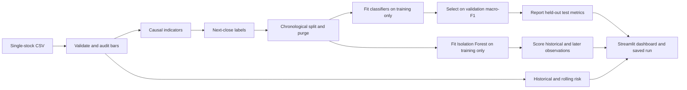

# ◈ MarketSense

**Market Behaviour, Risk and Anomaly Analysis** — a local, educational machine-learning mini-project for a team of four.

MarketSense reads real daily OHLCV data, compares next-observation direction classifiers, measures historical risk, and detects statistical outliers. A dark Streamlit dashboard makes the methods and their limitations visible. It does not execute trades or promise investment returns.

## Quick start

Use **Python 3.11 or 3.12**. No API keys, paid services, or cloud infrastructure are required.

macOS / Linux:

```bash
python3.12 -m venv .venv
source .venv/bin/activate
python -m pip install -r requirements.txt
python -m pytest -q
streamlit run app.py
```

Windows PowerShell:

```powershell
py -3.12 -m venv .venv
.\.venv\Scripts\Activate.ps1
python -m pip install -r requirements.txt
python -m pytest -q
streamlit run app.py
```

If PowerShell blocks activation, use `.\.venv\Scripts\python.exe -m pip ...` and `.\.venv\Scripts\python.exe -m streamlit run app.py` directly. Installing dependencies requires internet once; analysis then runs offline. On the development machine, an existing Anaconda installation was used to create a project-local Python 3.12 environment: `.venv/bin/python -m streamlit run app.py` works directly.

## Get real data

Download [Boris Marjanovic's Huge Stock Market Dataset](https://www.kaggle.com/datasets/borismarjanovic/price-volume-data-for-all-us-stocks-etfs/) from Kaggle. Its data card lists **CC0 / Public Domain**, adjusted OHLCV, and a final update in November 2017. A free Kaggle account may be needed; the project does not need a Kaggle API token.

Extract one file, such as `Stocks/aapl.us.txt`, into `data/raw/`, or upload it in the dashboard. The `.txt` extension is supported because the content is CSV. Do not rename or concatenate different instruments into one series.

```text
Date,Open,High,Low,Close,Volume
```

Require at least **301 valid daily bars**, yielding at least 250 labelled observations after the 50-bar warm-up. Prefer several years. There is no synthetic demo-data fallback. Synthetic fixtures in `tests/` check software correctness only; their scores are never reported as financial results. See [dataset guidance](docs/dataset.md) for provenance and cleaning details.

## Run the complete ML pipeline

```bash
python train.py --data data/raw/aapl.us.txt --symbol AAPL
python train.py --data data/raw/aapl.us.txt --symbol AAPL --output models/aapl_experiment_01
python train.py --data data/raw/aapl.us.txt --symbol AAPL --risk-window 30 --low-risk 0.15 --high-risk 0.30 --contamination 0.03
```

Output is a new directory containing `models.joblib`, `report.json`, feature/risk/anomaly CSVs, and held-out prediction tables. Existing run directories are protected from overwriting. Metadata includes the data hash, feature order, class names, parameters, split dates, runtime versions, and seed. **Only load joblib files you created or trust**, using matching dependency versions. The dashboard trains through the same service; it does not deserialize uploaded model files.

The dashboard has five sections: Overview, Market Behaviour, Risk Analysis, Anomaly Detection, and Model Evaluation. It displays the dataset's actual date range, source price units, cleaning audit, model selection criterion, held-out predictions, and unknown latest-row outcome.

## Architecture



```text
app.py                         Five-section Streamlit dashboard
train.py                       Command-line training entry point
config/settings.py             Validated, configurable assumptions
src/data_loader.py             CSV reading
src/preprocessing.py           Schema checks, conservative cleaning and audit
src/feature_engineering.py     Causal indicators and separate target creation
src/market_prediction.py       Purged splits, pipelines and fixed model comparison
src/evaluation.py              Classification metrics
src/risk_analysis.py           Historical and rolling risk
src/anomaly_detection.py       Training-only Isolation Forest and score context
src/analysis.py                Shared orchestration and artifact saving
src/visualization.py           Plotly figures
data/raw/                      Local source CSVs, ignored by Git
data/processed/                Reserved for local analysis exports, ignored
models/                        Local run directories, ignored
notebooks/exploration.ipynb    EDA companion; no model logic duplicated here
tests/                         Leakage, formula, integration and dashboard checks
docs/                          Dataset, methodology, academic guide and progress
scripts/check_secrets.py       Tracked-file credential preflight
.github/workflows/tests.yml    Cross-platform pipeline checks
```

The additions to the suggested structure are `src/analysis.py`, `train.py`, and a small script/CI directory. They keep the UI and CLI consistent and make the project reviewable without adding a backend service.

## Methodology

- **Features:** daily return, rolling mean returns, SMA 10/20/50, EMA 12/26, 20-bar volatility, RSI 14, MACD/signal, volume change/relative volume, 10-bar momentum, and intraday range. Price ratios reduce raw price-level dependence. All inputs are available at the observation's close.
- **Target:** Bullish if the next supplied trading close is higher; Bearish for a negative or zero next return. The last row remains unlabelled. Three-class Neutral is deliberately deferred until a threshold can be justified and evaluated.
- **Splits:** chronological 60/20/20 on feature-complete labelled rows. Remove training/validation rows whose next-close labels reach the following partition. No random shuffling.
- **Models:** majority-class baseline, scaled Logistic Regression, depth-limited Random Forest, and shallow Gradient Boosting. Fixed hyperparameters avoid a large tuning search. Every model fits only training; select by validation macro-F1, including the baseline. No test refit. Ties follow model insertion order.
- **Metrics:** accuracy, macro precision/recall/F1, per-class report/support and confusion matrix, with explicit Bearish/Bullish ordering. Probabilities are **uncalibrated**. Feature importance reflects association, not causality.
- **Risk:** sample historical standard deviation, annualization by √252, peak-to-current drawdown, positive-loss historical 95% one-day VaR, and downside deviation about zero. Current risk class uses rolling annualized volatility: Low <15%, Moderate 15% to <30%, High ≥30%, configurable. These teaching thresholds are not universal investment-risk ratings.
- **Anomalies:** Isolation Forest uses training-period return, volatility, volume and range features, then scores later observations without refitting. Inverted decision function >0 indicates an outlier. Contamination controls the training threshold, not the future anomaly frequency. Top training-standard-deviation indicators provide context, not causal forest explanations.

See [methodology and equations](docs/methodology.md) for the full protocol and [academic guide](docs/academic_guide.md) for viva preparation, research alignment, limitations, future scope, and team responsibilities.

## Model comparison and evidence

No benchmark scores are hardcoded. Run the CLI on the acquired dataset to generate a genuine comparison in `report.json`, or inspect Model Evaluation in the dashboard. Both validation and held-out test comparisons are saved. A test score above 50% does not establish predictability, statistical significance, or profitability.

Automated tests check causal feature invariance under future perturbation, unknown final labels, boundary purging, training-only scaling/anomaly statistics, known risk formulas, artifact round-trips, and all dashboard sections. See [implementation record](docs/implementation.md) for completed phases and verification status.

## Costs, licenses and credentials

Project code is [MIT licensed](LICENSE). The dependencies are free/open-source; their licenses still apply when redistributing them. The recommended dataset is separately marked CC0 by its publisher. Kaggle access is subject to Kaggle's platform terms. Local use requires your own computer, disk and internet for installation/downloads; no paid integration is implemented.

The included GitHub workflow is **manual-only** and uses no custom secrets: publishing commits does not start hosted jobs. If you choose Actions → ML pipeline checks → Run workflow, private-repository runs can count against the account's included quota; keep paid overages disabled if you want no paid hosted compute usage. Optional future hosting, external feeds, and this coding assistant's own service usage are separate from the project's runtime costs.

`.gitignore` excludes datasets, trained models, environments, `.env`, cloud/SSH configuration, and common credential files. Before committing, run `git status --short`, inspect the staged diff, and run `python scripts/check_secrets.py`. This preflight catches common patterns, not every possible secret. Never paste tokens into code, notebook outputs, remote URLs, or commits. The app itself has no authentication credentials to configure.
